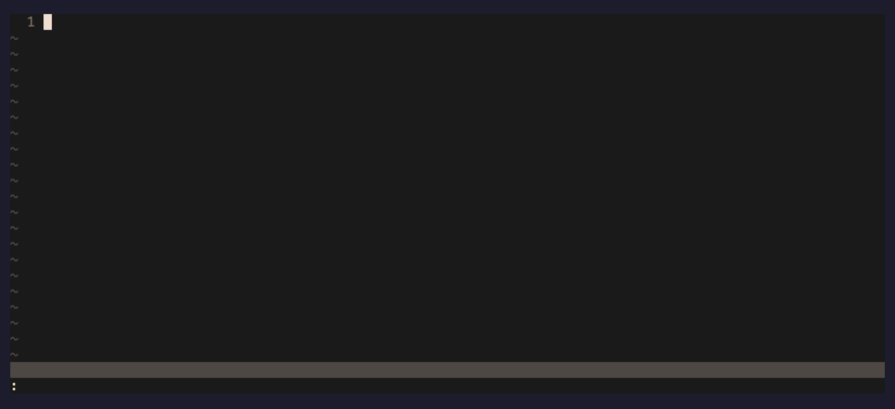
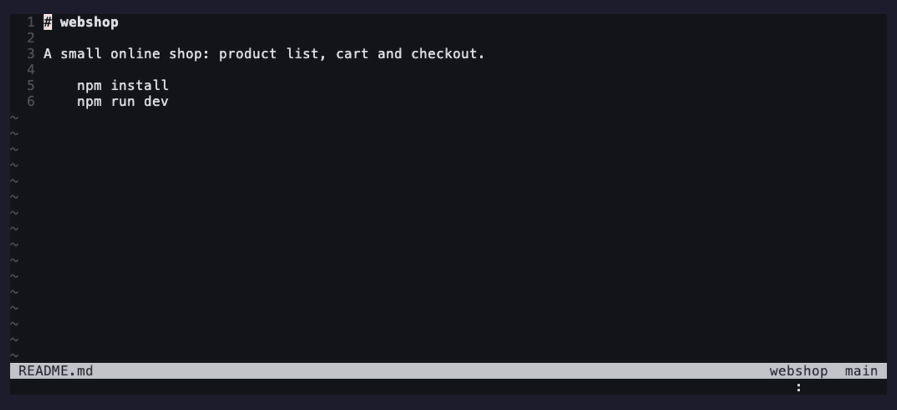
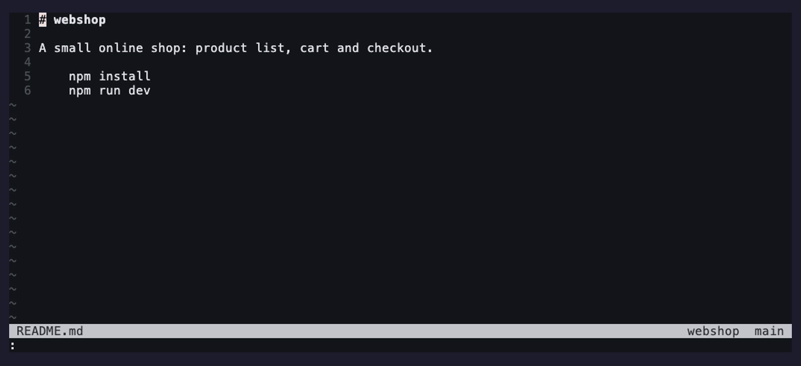
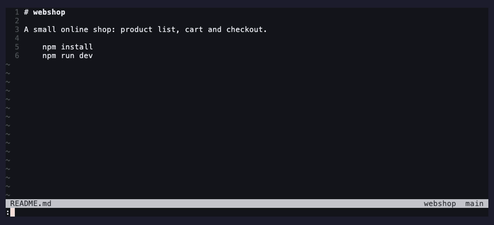

# vim-project

Projects for Vim and Neovim: switch between them, find files and text, replace across files, run tasks and work with git, all scoped to the project you are in.

[](https://github.com/leafOfTree/vim-project/actions/workflows/main.yml) [](UNLICENSE)



## Why vim-project

- **Vim and Neovim**: plain Vimscript, Vim 8.2+ and Neovim 0.5+.
- **No freezing**: searches run in the background.
- **Git like an IDE**: changelists, shelves, background pull and push.
- **Per project**: session, history, config and tasks.
- **Fast search**: with fd, rg or ag (recommended), or find and grep.

## Quick start

Needs Vim 8.2.3591+ or Neovim 0.5.1+, and git for the git features. [fd](https://github.com/sharkdp/fd) and [rg](https://github.com/BurntSushi/ripgrep) (or [ag](https://github.com/ggreer/the_silver_searcher)) are recommended for fast search; without them, find, grep and Vim's `:vimgrep` are used.

<details>
<summary>Install with lazy.nvim, vim-plug or Vim packages</summary>

```lua
-- lazy.nvim
{ 'leafOfTree/vim-project', lazy = false }
```

```vim
" vim-plug
Plug 'leafOfTree/vim-project'
```

```sh
# Vim's built-in packages
git clone https://github.com/leafOfTree/vim-project ~/.vim/pack/plugins/start/vim-project
```

For icons, add a [Nerd Font](https://github.com/ryanoasis/nerd-fonts) with [nerdfont.vim](https://github.com/lambdalisue/nerdfont.vim), and [glyph-palette.vim](https://github.com/lambdalisue/glyph-palette.vim) to color them.

To uninstall, remove the plugin and `config_home` (`~/.vim/vim-project-config` by default).

</details>

Add a project and start working:

```vim
:Project ~/code/my-app      " add a folder as a project and open it
:ProjectList                " switch to another project
:ProjectSearchFiles         " find a file by name
:ProjectFindInFiles         " find text in the project
```

Mapping the commands you use most is worth it, for example:

```vim
nnoremap <leader>p :ProjectList<CR>
nnoremap <leader>f :ProjectSearchFiles<CR>
noremap  <leader>g :ProjectFindInFiles<CR>
```

For the full reference: `:help vim-project` (run `:helptags ALL` first if your plugin manager does not).

<details>
<summary>The config of the demos, and how to run them</summary>

The demos use this config, with `npm` in place of their scripts. `project_root` opens each project at its `README.md` rather than its folder:

```vim
let g:vim_project_config = {
      \'project_base': ['~/code'],
      \'project_root': './README.md',
      \'tasks': [
      \  {'name': 'test', 'cmd': 'npm test'},
      \  {'name': 'dev', 'cmd': 'npm run dev'},
      \  {'name': 'lint', 'cmd': 'npm run lint'},
      \],
      \}

" joshdick/onedark.vim
colorscheme onedark
" The file on the left, the project and its branch on the right
let &statusline = "%f%m%=%{empty(g:vim_project) ? '' : g:vim_project.name.'  '.get(g:vim_project, 'branch', '')} "
```

To try the projects of the demos, without changing your own config:

```sh
git clone https://github.com/leafOfTree/vim-project && cd vim-project
docs/demo/setup.sh    # webshop and five other projects in /tmp/vim-project-demo
vimrc=$PWD/docs/demo/vimrc && cd /tmp/vim-project-demo/projects && nvim -u "$vimrc"
```

Then `:ProjectList` and pick `webshop`.

</details>

## Features

In every list, type to filter. <kbd>Ctrl-j</kbd> / <kbd>Ctrl-k</kbd> (or the arrow keys) move, <kbd>Enter</kbd> opens and <kbd>Esc</kbd> closes. See [keys in lists](#keys-in-lists).

### Projects

<details open>
<summary>Watch the demo</summary>


</details>

`:ProjectList` filters projects by name, note or path. Opening a project quits the current one (saving its session if enabled) and opens the new one's root.

- `:Project <path> ["note"]` adds a folder. A relative path is looked up in `project_base`.
- `:ProjectNew <path>` creates a new project from a template task, e.g. `git clone`.
- `:ProjectRename`, `:ProjectRemove`, `:ProjectQuit` manage them.
- `project_views` define views of the list, switched with <kbd>Tab</kbd> and <kbd>Shift-Tab</kbd>.

### Search files

<details open>
<summary>Watch the demo</summary>



</details>

`:ProjectSearchFiles` matches fuzzily, so typing a few letters of each part is enough:

| Input | Finds | |
|-------|-------|-|
| `pcard` | `ProductCard.vue` | file names |
| `store/c` | `src/store/cart.js` | with `/`, the path too |
| `comp/pcard` | `src/components/ProductCard.vue` | both parts can be shortened |
| `store/` | the `store` directory | ending with `/`, directories only |

Recently opened files come first. <kbd>Ctrl-s</kbd>, <kbd>Ctrl-v</kbd> and <kbd>Ctrl-t</kbd> open in a split, vertical split or tab.

The file list is cached and refreshed in the background, so new files show up without waiting.

### Find and replace in files

<details open>
<summary>Watch the demo</summary>


</details>

`:ProjectFindInFiles` searches as you type; with a visual selection it starts with the selected text. The input is literal and case insensitive: start it with `\C` to match case, or `\E` for a regular expression.

To replace, press <kbd>Ctrl-r</kbd>, type the replacement after ` => `, check the preview, and confirm with <kbd>Ctrl-y</kbd>. <kbd>Ctrl-d</kbd> leaves out a line or file.

### Run tasks

<details open>
<summary>Watch the demo</summary>


</details>

`:ProjectRun` lists the `tasks` of the project and shows their output as they run. <kbd>Enter</kbd> runs or reruns a task, <kbd>Ctrl-q</kbd> stops it and <kbd>Ctrl-o</kbd> opens its terminal.

```vim
let g:vim_project_local_config = {
      \'tasks': [
      \  {'name': 'test', 'cmd': 'npm test'},
      \  {'name': 'dev', 'cmd': 'npm run dev'},
      \  {'name': 'script', 'cmd': 'npm run', 'args': 'script name'},
      \  {'name': 'terminal', 'cmd': ''},
      \],
      \}
```

`args` asks for input appended to the command, `cd` runs it in a sub folder, `show` and `hide` filter its output by patterns, and an empty `cmd` opens a terminal.

### Git changes

<details open>
<summary>Watch the demo</summary>



</details>

`:ProjectGitStatus` shows local changes with a diff of the file under the cursor. Group them in changelists, then commit one at a time: only its files are committed.

| Key | Action |
|-----|--------|
| <kbd>Enter</kbd> | open a file, expand or collapse a changelist |
| <kbd>a</kbd> / <kbd>r</kbd> / <kbd>d</kbd> | new, rename, delete a changelist |
| <kbd>m</kbd> | move files or a changelist to another changelist |
| <kbd>c</kbd> | commit the changelist or selected files (write `amend` alone on a line to amend) |
| <kbd>R</kbd> | roll back the selected files |
| <kbd>s</kbd> | shelve: save the changes as a patch and revert them |
| <kbd>S</kbd> | unshelve a shelf or one of its files |
| <kbd>u</kbd> / <kbd>p</kbd> / <kbd>P</kbd> | pull, push, pull then push, in the background |
| <kbd>A</kbd> | abort the merge, rebase, cherry-pick or revert in progress |

Merge conflicts: a pull or branch merge that stops on conflicts opens the Unmerged changelist. <kbd>Enter</kbd> on a file opens a three-pane merge window, yours | result | theirs, with each conflict colored by state. Press <kbd>&lt;</kbd> yours, <kbd>&gt;</kbd> theirs, <kbd>=</kbd> both, <kbd>e</kbd> edit, <kbd>u</kbd> undo, <kbd>]c</kbd> / <kbd>[c</kbd> move, <kbd>w</kbd> or <kbd>q</kbd> to accept (write and `git add`) once all are resolved, <kbd>Q</kbd> to discard. After the last file it offers to commit the merge or continue the rebase.

### Git log, file history, branches and tags

<details open>
<summary>Watch the demo</summary>



</details>

- `:ProjectGitLog` searches commits by message, author or hash, with the changed files of the selected one beside it.
- `:ProjectGitFileHistory` shows the commits of the current file, or of the selected lines, with their diffs.
- `:ProjectGitBranch` switches, creates and merges branches.
- `:ProjectGitTag` checks out and creates tags.

| List | Key | Action |
|------|-----|--------|
| log | <kbd>Enter</kbd> | show the changed files, and the diff of the one under the cursor |
| log, file history | <kbd>Ctrl-o</kbd> | check out |
| file history | <kbd>Enter</kbd> | show the diff |
| branches | <kbd>Enter</kbd> | switch to it, or create one from `New Branch` |
| branches | <kbd>Ctrl-o</kbd> | merge into the current branch (asks first) |
| tags | <kbd>Enter</kbd> | check out, or create one from `New Tag` |

### Sessions and project config

- `use_session` saves and restores the windows and buffers of each project; with `check_branch_when_use_session`, one per git branch.
- `use_viminfo` keeps command and search history, marks and recent files per project.
- `:ProjectConfig` opens the project's `init.vim`, sourced when it opens and reloaded when saved. Set `g:vim_project_local_config` there to override options for that project.
- `file_mappings` jump to files you edit often, e.g. `'r` for `README.md`. See `:help vim-project-file-mappings`.

## Configuration

Set `g:vim_project_config` before the plugin loads (with lazy.nvim, in `init`). Only the keys you set change:

```vim
let g:vim_project_config = {
      \'project_base': ['~/code'],
      \'use_session': 1,
      \'exclude': ['.git', 'node_modules', 'dist'],
      \}
```

| Option | Default | Description |
|--------|---------|-------------|
| `config_home` | `'~/.vim/vim-project-config'` | where projects, sessions and per-project config are kept |
| `project_base` | `['~']` | where relative paths of `:Project` are looked up |
| `project_root` | `'./'` | folder or file to open with a project |
| `include` / `exclude` | `[]` / `['.git', 'node_modules', ...]` | what search and find in files look at |
| `use_session` / `use_viminfo` | `0` | per project session and history |
| `auto_detect` | `'no'` | `'ask'` or `'always'` to add folders with `.git` you open |
| `tasks` | `[]` | tasks for `:ProjectRun` |
| `find_replace_separator` | `' => '` | separator of search and replace text |
| `file_mappings_prefix` | `"'"` | key before `file_mappings` keys |

Every option, key mapping and the per-project config are in `:help vim-project-config`.

### Status line

`g:vim_project` holds the current project (`name`, `path`, `branch`, ...) and `$vim_project` its path, e.g.

```vim
set statusline=%f%=%{empty(g:vim_project)?'':g:vim_project.name}
```

## Keys in lists

| Key | Action |
|-----|--------|
| <kbd>Enter</kbd> | open |
| <kbd>Esc</kbd> | close |
| <kbd>Ctrl-j</kbd> / <kbd>Ctrl-k</kbd>, <kbd>↓</kbd> / <kbd>↑</kbd> | next / previous item |
| <kbd>Ctrl-h</kbd> / <kbd>Ctrl-l</kbd> | first / last item |
| <kbd>Ctrl-n</kbd> / <kbd>Ctrl-p</kbd> | scroll down / up |
| <kbd>Backspace</kbd> / <kbd>Ctrl-w</kbd> / <kbd>Ctrl-u</kbd> | delete a character / word / everything |
| <kbd>Ctrl-b</kbd> | paste |
| <kbd>Ctrl-o</kbd> | go to the list window (in lists without their own <kbd>Ctrl-o</kbd>) |

All of them can be changed with `list_mappings`. Typed characters are highlighted with the `VimProjectMatch` group, e.g. `highlight VimProjectMatch guifg=#f9e2af gui=bold`.

## Commands

| Command | Description |
|---------|-------------|
| `:Project <path> ["note"]` | add a folder as a project and open it |
| `:ProjectNew <path>` | create a new project |
| `:ProjectList` | list and open projects |
| `:ProjectOpen <name>` | open a project by name |
| `:ProjectQuit` | quit the current project |
| `:ProjectRename <name> <new_name>` | rename a project and its folder |
| `:ProjectRemove <name>` | remove a project from the list |
| `:ProjectIgnore <path>` | never offer a folder in `auto_detect` |
| `:ProjectSearchFiles` | search files by name |
| `:ProjectSearchFilesReset` | forget the cached file list |
| `:ProjectFindInFiles [text]` | find and replace in files |
| `:ProjectRun` | run tasks |
| `:ProjectGitStatus`, `:ProjectGitCommit` | local changes and changelists |
| `:ProjectGitLog` | search the git log |
| `:ProjectGitFileHistory` | history of the file or selected lines |
| `:ProjectGitBranch` / `:ProjectGitTag` | branches / tags |
| `:ProjectRoot` | open the project root |
| `:ProjectConfig` / `:ProjectAllConfig` | edit the project's `init.vim` / the project list |
| `:ProjectConfigReload` | write all buffers and reopen the project |
| `:ProjectInfo` / `:ProjectAllInfo` | show the project and config in use |
| `:ProjectOutput [filter]` | print the projects |

## Troubleshooting

- **A command is much slower than in a terminal.** Try setting `shell` to `sh` (or `cmd.exe` on Windows).
- **`'a` no longer jumps to mark a.** `file_mappings` use `'` by default; set `file_mappings_prefix` to e.g. `'<leader>'`.
- **Git push or pull fails asking for credentials.** They run in the background without a terminal; use a credential helper or ssh-agent.
- **Something else.** `:ProjectInfo`, `:ProjectAllInfo` and `let g:vim_project_config.debug = 1` show what is going on.

## Development

```sh
bash test/run.sh                                # tests with every editor found (or: nvim, vim)
VIM_PROJECT_TEST_CASES=perf bash test/run.sh    # time budgets of the code run on every key
vint --error plugin autoload
docs/demo/render.sh                             # re-record the animations above with VHS
```

See [CONTRIBUTING.md](CONTRIBUTING.md) for how the tests, time budgets and demos work.

## Credits

Thanks to timsofteng for the great idea. It all started with that.
